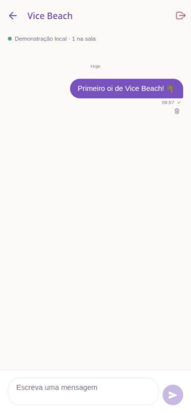
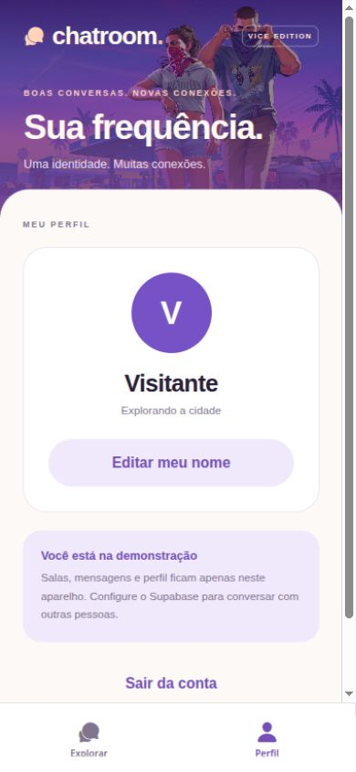

# ViceRoom 🌴

**Encontre sua sala. Converse em tempo real. Sinta a vibe.**

Aplicativo de chat para Android, iOS e web, com visual inspirado no pôr do sol de GTA VI: roxo, rosa e pêssego. Crie uma sala, encontre sua turma e acompanhe quem está online e digitando.

<p align="center">
  
  
  
</p>

## O que o app faz

- Cadastro, login e perfil com nome e avatar.
- Busca de salas públicas, filtro de participação e criação de novas salas.
- Entrada e saída explícitas: só participantes leem e enviam mensagens.
- Mensagens em tempo real, envio imediato na tela e exclusão das próprias mensagens.
- Presença online e aviso de digitação.
- **Demonstração local:** experimente sem criar conta ou configurar um servidor.

## Rodar em poucos passos

Requer Node.js **22.13+ na linha 22**, **24.3+ na linha 24** ou **26+**.

```bash
git clone https://github.com/ApenasGui/viceroom-chat.git
cd viceroom-chat
npm ci
npm run web
```

Na tela de entrada, escolha **Explorar demonstração**. Os dados ficam salvos no aparelho; a demonstração não conecta pessoas nem sincroniza dispositivos.

Para abrir no celular, use `npm start` e o Expo Go compatível com o SDK 58, ou um development build.

### Ativar o chat real

1. Crie um projeto Supabase e execute [`supabase/schema.sql`](supabase/schema.sql).
2. Copie `.env.example` para `.env` e preencha a URL e a chave **pública** do projeto.
3. Reinicie com `npx expo start -c`, cadastre sua conta e crie uma sala.

O cadastro por e-mail precisa estar habilitado no Supabase. Se houver confirmação de e-mail, confirme antes de entrar. Nunca use uma chave `service_role` no app. Veja o [guia de configuração e testes](docs/SETUP.md) para os detalhes.

## Por dentro

**React Native · Expo Router · TypeScript · Supabase · TanStack Query · React Hook Form · Zod**

A arquitetura segue **tela → hook → serviço → dados**, com componentes e tema compartilhados. O banco usa RLS para proteger as mensagens e cria o perfil automaticamente no cadastro.

```text
app/         Telas e navegação
src/         Componentes, hooks, serviços, validação e tema
supabase/    SQL e testes de integração com Postgres
__tests__/   Testes do app e regressões
```

## Qualidade

```bash
npm run typecheck
npm test
```

**40 testes:** 25 no app com Jest e 15 no banco com PGlite. Exportações para web, Android e iOS verificadas. O tempo real entre aparelhos deve ser validado após configurar o Supabase; a demonstração local não testa WebSockets reais.

## Fluxo de desenvolvimento

`feature/*` → PR para `develop` → `release/*` → `main` e tag de versão. Correções urgentes usam `hotfix/*`. Commits seguem Conventional Commits (`feat:`, `fix:`, `docs:`, `chore:`).

---

Projeto acadêmico não oficial, inspirado em GTA VI. A arte de referência pertence aos seus respectivos titulares; substitua `assets/vice-sunset.png` ao adotar uma identidade visual própria.
